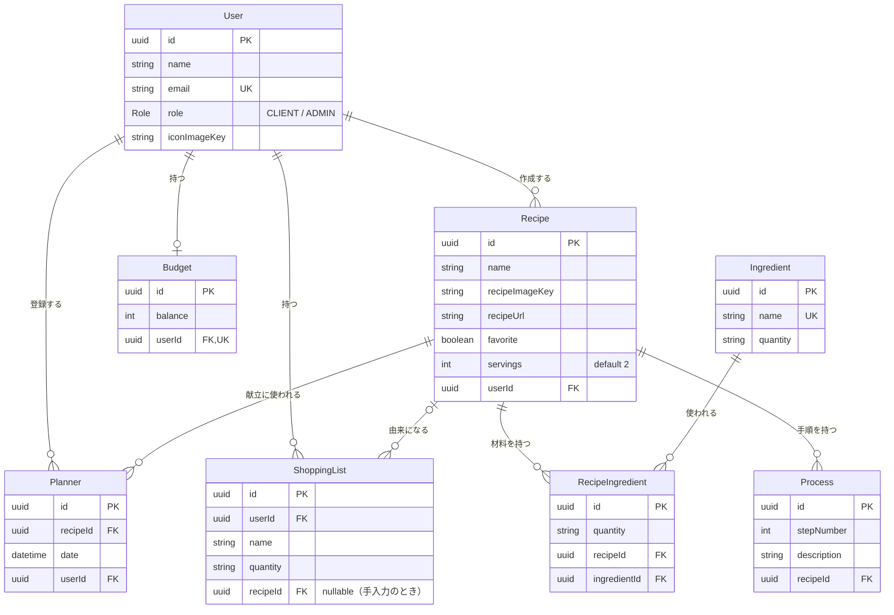

# TABERU（タベル）

献立やレシピから、買い物リストを自動で作るWebアプリです。

献立を決めるたびに、手作業で買い物リストを作るのが面倒だった、という自分自身の不便から作りました。「自分がずっと使い続けたいか」を基準に機能を選んでいます。

## URL

- 本番環境：https://origin-app-rust.vercel.app/

### テスト用アカウント

ログインが必要なアプリのため、確認用のアカウントを用意しています。サンプルのレシピ・献立・買い物リストが登録済みです。

| 項目 | 内容 |
|---|---|
| メールアドレス | greenboys193+test@gmail.com |
| パスワード | taberu_test |

## 主な機能

### 買い物リスト
- レシピ・献立から、材料をまとめて買い物リストに自動追加
- 材料を手入力して、買い物リストを作成
- アイテムごとの削除と、リストの一括削除

### レシピ
- レシピの登録・編集・削除（材料・分量・手順・人数）
- お気に入り登録と、お気に入りだけの一覧表示
- **AIによる人数変換**：人数を選ぶと、材料の分量を自動で換算
- **AIによるレシピ作成**：料理名・材料名・画像からレシピの下書きを自動で作成（内容を確認してから保存）

### 献立
- レシピと日付を選んで献立を作成
- 献立からレシピ詳細や買い物リストへ移動

### 予算
- 食費の予算と残高の管理

### アカウント
- メールアドレス／Googleアカウントでのログイン・新規登録
- パスワード再設定
- プロフィール（表示名・アイコン）の編集、退会

## 使用技術

| 分類 | 技術 |
|---|---|
| フロントエンド | Next.js（App Router）、TypeScript、Tailwind CSS |
| バックエンド | Next.js（Route Handlers）、Prisma |
| データベース・認証 | Supabase（PostgreSQL、Auth、Storage） |
| AI | Mastra（AIエージェントフレームワーク）、Gemini API、Zod |
| インフラ | Vercel |
| その他 | Git / GitHub、Figma、Miro、Notion |

## 設計

- 画面設計（Figma）：https://www.figma.com/design/xXYINf8fYQ8yRoWoruIdfh/%E3%82%AA%E3%83%AA%E3%82%B8%E3%83%8A%E3%83%AB%E3%82%A2%E3%83%97%E3%83%AA%EF%BC%88UI%E3%83%87%E3%82%B6%E3%82%A4%E3%83%B3%EF%BC%89?node-id=0-1&t=M16lfRvmYPslhW64-1

※ 画面設計は開発前に作成したものです。実装の過程で、使いやすさを優先して画面を一部変更しています。

- ER図（Miro）：https://miro.com/app/board/uXjVHvT2QqA=/?share_link_id=410235941565



### 主なテーブル

| テーブル | 役割 |
|---|---|
| User | ユーザー情報（表示名・アイコン） |
| Recipe | レシピ本体（人数・参考URL・お気に入り） |
| Ingredient | 材料マスター |
| RecipeIngredient | レシピと材料の中間テーブル（レシピごとの分量） |
| Process | 作り方の手順 |
| Planner | 献立（日付とレシピ） |
| ShoppingList | 買い物リストのアイテム |
| Budget | 予算・残高 |

## 工夫したところ

- **DB設計**：材料をマスターテーブルにし、中間テーブルで管理することで、同じ材料でもレシピごとに違う分量を持てるようにしました。
- **セキュリティ**：すべてのAPIでトークンを検証し、ユーザーIDでデータを絞り込んで、他のユーザーのデータに触れられないようにしました。
- **AI機能**：Mastraで人数変換とレシピ作成のエージェントを実装しました。出力をZodで構造化し、ユーザーが内容を確認してから保存する流れにしています。Geminiの無料枠で安定して動かすため、レート制限にかかりにくいLite版のモデルを選び、画像とテキストを分けて渡すことで、意図どおりの出力になるよう調整しました。
- **進め方**：実装前にAPIリスト（エンドポイント・メソッド・作成するファイル）と画面リストを作り、それに沿って機能ごとにブランチとPRを分けて開発しました。AIを使って実装した部分も、意図を自分の言葉で説明できる状態にしてからレビューに出しています。

## 今後の課題

- 買い物リストの、同じ材料のまとめ表示

## 開発者向けセットアップ

### 1. リポジトリをクローン
```bash
git clone https://github.com/Katsuo1536/origin-app.git
cd origin-app
```

### 2. パッケージをインストール
```bash
npm install
```

### 3. 環境変数を設定
`.env.local` を作成し、以下を設定します。

```env
DATABASE_URL=            # Supabase の接続文字列
DIRECT_URL=              # マイグレーション用の接続文字列
NEXT_PUBLIC_SUPABASE_URL=
NEXT_PUBLIC_SUPABASE_ANON_KEY=
GOOGLE_GENERATIVE_AI_API_KEY=   # Gemini API（Mastra で使用）
```

### 4. DBをセットアップ
```bash
npx prisma migrate dev
npx prisma generate
```

### 5. 開発サーバーを起動
```bash
npm run dev
```

### その他のコマンド
| コマンド | 内容 |
| --- | --- |
| `npm run build` | 本番ビルド |
| `npm run lint` | ESLintによる静的解析 |


## 開発者

橋元 勝美

- X：https://x.com/katsuo_code
- Instagram：https://www.instagram.com/katsuo_code
- Threads：https://www.threads.com/@katsuo_code
- ShiftB（学習記録）：https://shiftb.vibely.site/m/katsuo_code

開発の進み具合を、毎日SNSで発信しています。
